 
 

 

# 🚀 Awesome LLM Prompting & Guidance 🧠

> A curated list of awesome **LLM prompting & guidance frameworks**, **structured output engines**, **constrained generation libraries**, and **prompt engineering tools** for production AI applications. 🎯

---

## 📖 Overview 🌐

Modern AI engineering has moved beyond brittle string templates and unpredictable markdown responses. **LLM Prompting & Guidance** tools empower developers to reliably control how Large Language Models generate text—enforcing strict JSON schemas, constraining token-level logits via grammars/regex, validating responses, and composing multi-step reasoning chains into deterministic, type-safe workflows. 🛡️

Whether you are targeting hosted cloud APIs (OpenAI, Anthropic Claude, Google Gemini) or running high-throughput self-hosted open-weight models (via vLLM, SGLang, Ollama, TGI, or llama.cpp), this curated directory highlights the leading open-source libraries and SaaS solutions. ⚡

### 🔑 Key Capabilities Covered
- 📐 **Structured Outputs & Schema Extraction**: Enforce Pydantic models, JSON Schemas, and TypeScript interfaces with automatic retry and validation.
- 🎯 **Constrained Decoding & Token Masking**: Guide token logits with finite state machines (FSM) or context-free grammars (CFG) for 100% schema compliance.
- 🔀 **Interleaved Generation & Prompt Control Flow**: Combine prompt logic, branching, loops, and generation in unified programs.
- 🛡️ **Guardrails & Evaluation**: Enforce safety rails, PII detection, toxicity filtering, and automated regression testing.

---

## 📑 Table of Contents 📌

- [📊 Sector Overview & Market Dynamics](#-sector-overview--market-dynamics)
- [☁️ SaaS & Hosted Platforms](#️-saas--hosted-platforms)
- [⚡ Quick Comparison Matrix](#-quick-comparison-matrix)
- [🐙 Open-Source Prompt Guidance Frameworks](#-open-source-prompt-guidance-frameworks)
- [🛠️ Prompt Engineering & Evaluation Tools](#️-prompt-engineering--evaluation-tools)
- [🧭 How to Choose the Right Tool](#-how-to-choose-the-right-tool)
- [🤝 How to Contribute](#-how-to-contribute)
- [⚠️ Disclaimer](#️-disclaimer)
- [💖 Support](#-support)
- [📈 Star History](#-star-history)

---

## 📊 Sector Overview & Market Dynamics 📈

The global prompt engineering and LLM management software market is estimated at **$1.8B – $2.6B in 2025–2026** (growing at a 28–33% CAGR), driven by enterprise transitions from raw API experimentation to production LLMOps and governance. 

Market dynamics demonstrate a **two-tier structure**: the underlying foundation model API layer is a **highly concentrated, winner-take-most oligopoly** (dominated by OpenAI, Google, and Anthropic), while the prompt guidance, structured decoding, and validation tooling layer remains **moderately fragmented**, actively contested between specialized open-source engines (e.g., Outlines, Instructor, Guidance, DSPy) and converging LLMOps infrastructure vendors. 🏢🔄

---

## ☁️ SaaS & Hosted Platforms 🏢

The following hosted platforms provide native server-side structured outputs, schema enforcement, and tool/prompt guidance APIs, sorted descending by corporate valuation / scale:

| Product / Provider | Company Scale (Valuation / Revenue) | Specific Starting Tier Pricing | Free Tier / Free Trial Limits | Key Schema & Guidance Highlights |
| :--- | :--- | :--- | :--- | :--- |
| **[Google Cloud / Gemini API](https://ai.google.dev/)** 🌐 | **Alphabet Inc. ($2.1T+ Market Cap / $350B+ Revenue)** | Starting paid tier: **$0.075 per 1M input tokens** / **$0.30 per 1M output tokens** (Gemini 1.5 Flash); billed pay-as-you-go via Google Cloud Billing | **Free forever plan available**: Free in Google AI Studio with limits of **15 requests per minute (RPM)**, **1,500 requests per day (RPD)**, and 1M TPM (prompts may be used to train Google models on the free tier). | Server-side `response_schema` enforcement using OpenAPI 3.0 schemas; zero-client-side repair required for strict JSON output. |
| **[OpenAI Structured Outputs](https://platform.openai.com/docs/guides/structured-outputs)** 🤖 | **$157B+ Valuation (~$13B+ Run-rate Revenue)** | Starting tier (GPT-4o-mini): **$0.150 per 1M input tokens** / **$0.600 per 1M output tokens**; minimum prepaid account balance deposit is **$5.00** | **No ongoing free tier & no general automated free trial credits** (discontinued mid-2025). Requires minimum **$5.00 prepaid deposit** to start; academic grants provide 3–12 month limited research credits upon manual application. | Server-side constrained decoding with mathematical 100% adherence to supplied JSON Schemas via `json_schema` response format. |
| **[Anthropic Claude Tool & Schema API](https://www.anthropic.com/)** 🧠 | **$60B+ Valuation (~$4.6B+ Revenue)** | Starting tier (Claude 3.5 Haiku): **$0.80 per 1M input tokens** / **$4.00 per 1M output tokens**; Tier 1 unlocked with minimum **$5.00 deposit** | **14-day free trial** with **$5.00 one-time initial credit** upon account verification (expires in 14 days); Tier 1 baseline throughput cap of **$100.00/month maximum spend**. | Native tool calling schema compliance (`tool_choice: {"type": "tool"}`) for extracting typed JSON responses without formatting errors. |

> [!NOTE]
> Most standalone prompt guidance frameworks (e.g. Outlines, Guidance, Instructor) are open-source client-side and inference-engine libraries designed to run directly within your application process or self-hosted vLLM/SGLang cluster rather than as third-party SaaS middleboxes.

---

## ⚡ Quick Comparison Matrix 🔍

| Project | Approach | Best For | Backend Compatibility | Language / Ecosystem |
| :--- | :--- | :--- | :--- | :--- |
| **[DSPy](https://github.com/stanfordnlp/dspy)** 🎓 | Algorithmic Prompt Compilation | Optimizing prompts & weights automatically | Multi-provider (OpenAI, Anthropic, vLLM, local) | Python |
| **[SGLang](https://github.com/sgl-project/sglang)** ⚡ | High-Performance RadixAttention & Grammar Engine | Ultra-fast structured decoding & KV cache sharing | Open-weight models, vLLM backend, CUDA | Python |
| **[Promptfoo](https://github.com/promptfoo/promptfoo)** 🧪 | Test-Driven CI/CD Evaluation & Red-teaming | Security grading, prompt regression testing | Multi-provider (OpenAI, Claude, Azure, Ollama) | Node.js / CLI |
| **[Guidance](https://github.com/guidance-ai/guidance)** 🧭 | Interleaved Generation & Grammars | Complex branching, classification, stateful workflows | Local models, Transformers, select APIs | Python |
| **[DeepEval](https://github.com/confident-ai/deepeval)** 🔬 | Unit-Testing & Production AI Evaluation | Automated unit tests for LLM responses | Multi-provider | Python |
| **[Outlines](https://github.com/dottxt-ai/outlines)** 🎯 | Token-level Constrained Decoding (FSM/CFG) | Guaranteed 100% schema/JSON adherence | vLLM, llama.cpp, Transformers, TGI | Python |
| **[Instructor](https://github.com/instructor-ai/instructor)** 📐 | Pydantic Schema Validation & Retry | Document extraction, function calling | OpenAI, Anthropic, Gemini, Mistral, Ollama | Python, TypeScript, Go |
| **[Gorilla](https://github.com/ShishirPatil/gorilla)** 🦍 | Function Calling & Tool Invocation Fine-Tuning | Reliable multi-API function selection | Self-hosted, Berkeley Function Calling Leaderboard | Python |
| **[Phoenix](https://github.com/Arize-ai/phoenix)** 🔭 | AI Observability & Trace Evaluation | Tracing prompt chains, latency & evals | Multi-provider, OpenInference standard | Python / TypeScript |
| **[BAML](https://github.com/BoundaryML/baml)** 🧩 | Type-safe DSL + Prompt Playground | Microservices, enterprise prompt architectures | Multi-provider (OpenAI, Anthropic, local) | DSL (Python, TS, Go) |
| **[TypeChat](https://github.com/microsoft/TypeChat)** 💬 | TypeScript Schema Validation & Repair | Type-safe natural language interfaces | Hosted APIs (OpenAI, Azure OpenAI) | TypeScript / JavaScript |
| **[Guardrails AI](https://github.com/guardrails-ai/guardrails)** 🛡️ | Post-generation Validation Rails | Safety policies, PII filtering, structural validation | Multi-provider | Python |
| **[Marvin](https://github.com/prefecthq/marvin)** 🤖 | High-level Agentic & Data Framework | Fast prototyping, agent state & memory | Multi-provider | Python |
| **[Jsonformer](https://github.com/1rgs/jsonformer)** 📋 | Token-Masked JSON Decoding | Guaranteed JSON for Hugging Face models | Hugging Face Transformers | Python |
| **[LMQL](https://github.com/eth-sri/lmql)** 🔍 | Declarative Constraint Queries | Algorithmic prompts & declarative constraints | Local models, OpenAI | Python / LMQL |
| **[LM Format Enforcer](https://github.com/noamgat/lm-format-enforcer)** ⚙️ | Token Filtering Parser | Fast JSON/regex enforcement on self-hosted engines | vLLM, Transformers, llama.cpp | Python / C++ |

---

## 🐙 Open-Source Prompt Guidance Frameworks 💻

*Sorted descending by GitHub stargazers count:*

1. **[DSPy](https://github.com/stanfordnlp/dspy)**  🎓  
   **Stanford's declarative framework for programmatically optimizing prompt instructions and weights.**  
   Instead of hand-tuning prompts, DSPy compiles declarative modules into optimized instructions and few-shot exemplars tailored to specific metrics and models.  
   *Keywords*: `prompt-compilation`, `automated-prompt-engineering`, `stanford`, `optimization`

2. **[SGLang](https://github.com/sgl-project/sglang)**  ⚡  
   **High-throughput serving engine with structured generation and RadixAttention.**  
   SGLang co-designs runtime inference and front-end programming languages to deliver blazing fast constrained JSON decoding, multi-turn prompt caching, and grammar execution.  
   *Keywords*: `sglang`, `high-throughput`, `radix-attention`, `constrained-decoding`

3. **[Promptfoo](https://github.com/promptfoo/promptfoo)**  🧪  
   **CLI and CI/CD testing framework for LLM red-teaming, prompt regression, and security evaluation.**  
   Enables test-driven prompt engineering with deterministic assertions, vulnerability scans (prompt injection, jailbreaks), and side-by-side model output evaluations.  
   *Keywords*: `promptfoo`, `ci-cd`, `red-teaming`, `prompt-testing`, `security`

4. **[Guidance](https://github.com/guidance-ai/guidance)**  🧭  
   **Microsoft Research's interleaved generation and prompt control language.**  
   Lets developers interleave prompts, generation, and logical control flow into a continuous state. Eliminates parsing errors by constraining tokens to regex patterns or context-free grammars.  
   *Keywords*: `guidance`, `token-healing`, `constrained-generation`, `grammar-engine`

5. **[DeepEval](https://github.com/confident-ai/deepeval)**  🔬  
   **The open-source LLM evaluation framework like Pytest for AI applications.**  
   Facilitates unit testing prompt outputs against hallucination, answer relevancy, G-Eval metrics, and schema compliance in production and staging environments.  
   *Keywords*: `deepeval`, `llm-testing`, `hallucination-detection`, `rag-eval`

6. **[Outlines](https://github.com/dottxt-ai/outlines)**  🎯  
   **The constrained decoding engine for 100% guaranteed schema compliance.**  
   Outlines guides language model token sampling directly using finite-state machines (FSM), JSON schemas, and context-free grammars (CFGs). Natively integrated with **vLLM** for high-throughput self-hosted deployments.  
   *Keywords*: `outlines`, `constrained-decoding`, `vllm`, `regex-guided`, `fsm`

7. **[Instructor](https://github.com/instructor-ai/instructor)**  📐  
   **The Pydantic-first extraction and structured output standard.**  
   Wraps LLM provider SDKs (OpenAI, Anthropic, Gemini, Ollama) with Pydantic models. Handles schema formatting, validation, and auto-retries when model output is invalid. Available across Python, TypeScript, and Go.  
   *Keywords*: `instructor`, `pydantic`, `structured-outputs`, `json-schema`, `validation`

8. **[Gorilla](https://github.com/ShishirPatil/gorilla)**  🦍  
   **Berkeley's open model ecosystem for API calling and constrained tool execution.**  
   Specializes in enabling LLMs to accurately generate API calls, function arguments, and structured tool invocations without hallucinated parameters.  
   *Keywords*: `gorilla`, `tool-calling`, `function-calling`, `berkeley-eval`

9. **[Phoenix](https://github.com/Arize-ai/phoenix)**  🔭  
   **AI observability, prompt tracing, and evaluation playground by Arize AI.**  
   Provides OpenInference-based distributed tracing for multi-step prompt chains, agent executions, and structured output verification.  
   *Keywords*: `phoenix`, `observability`, `tracing`, `evals`, `openinference`

10. **[BAML](https://github.com/BoundaryML/baml)**  🧩  
    **Domain-specific language and interactive VS Code prompt development environment.**  
    Treats prompts as typed, compile-checked functions with an in-editor testing playground. Generates type-safe clients for Python, TypeScript, and Go with first-class streaming support.  
    *Keywords*: `baml`, `dsl`, `type-safety`, `playground`, `streaming-json`

11. **[TypeChat](https://github.com/microsoft/TypeChat)**  💬  
    **Microsoft's type-driven natural language interface builder.**  
    Uses TypeScript types as the prompt contract. TypeChat prompts models, validates output using the TypeScript compiler, and automatically repairs malformed schemas via targeted follow-ups.  
    *Keywords*: `typechat`, `typescript`, `natural-language-interface`, `schema-repair`

12. **[Guardrails AI](https://github.com/guardrails-ai/guardrails)**  🛡️  
    **Modular validation rails for structured outputs, PII redaction, and safety.**  
    Applies programmable quality controls to LLM outputs through reusable pip-installable validators with custom fallback, re-ask, and masking actions.  
    *Keywords*: `guardrails`, `ai-safety`, `pii-redaction`, `validation-rails`

13. **[Marvin](https://github.com/prefecthq/marvin)**  🤖  
    **Batteries-included agentic data framework by Prefect.**  
    A pragmatic Python library for generating synthetic data, extracting structured entities, and coordinating multi-agent workflows with built-in memory.  
    *Keywords*: `marvin`, `prefect`, `synthetic-data`, `structured-text`, `agents`

14. **[Jsonformer](https://github.com/1rgs/jsonformer)**  📋  
    **Bulletproof JSON decoding for Hugging Face Transformers.**  
    Generates fixed JSON structure tokens deterministically and lets the model generate only dynamic content tokens, ensuring 100% structural validity.  
    *Keywords*: `jsonformer`, `huggingface`, `json-decoding`, `transformers`

15. **[LMQL](https://github.com/eth-sri/lmql)**  🔍  
    **Declarative query and constraint language for language models.**  
    Integrates Python control flow with declarative SQL-style constraints, executing optimized token masking directly across backend decoders.  
    *Keywords*: `lmql`, `query-language`, `declarative-constraints`, `token-masking`

16. **[LM Format Enforcer](https://github.com/noamgat/lm-format-enforcer)**  ⚙️  
    **Token filtering engine for JSON Schemas and regex compliance.**  
    Fast parsing library designed for low-overhead token-level integration with vLLM, Hugging Face Transformers, and llama.cpp.  
    *Keywords*: `lm-format-enforcer`, `token-filtering`, `regex-enforcement`

---

## 🛠️ Prompt Engineering & Evaluation Tools 🧰

- 🧪 **[Promptfoo](https://github.com/promptfoo/promptfoo)** — Automated regression test runner, security red-teaming, and benchmark grading.
- 🔬 **[DeepEval](https://github.com/confident-ai/deepeval)** — Unit testing for hallucination detection, RAG retrieval accuracy, and metric scoring.
- 🔭 **[Phoenix](https://github.com/Arize-ai/phoenix)** — Prompt execution tracing, span evaluation, and OpenInference telemetry.
- 🎓 **[DSPy](https://github.com/stanfordnlp/dspy)** — Programmatic compilation of prompt instructions and few-shot exemplars.

---

## 🧭 How to Choose the Right Tool 🎯

| Scenario / Requirement | Recommended Solution |
| :--- | :--- |
| **Extracting structured data from Cloud APIs (OpenAI, Anthropic, Gemini)** | Use **[Instructor](https://github.com/instructor-ai/instructor)** (Python/TS/Go) for minimal friction and native Pydantic models. |
| **Self-hosting models with guaranteed 100% JSON/Schema adherence** | Use **[Outlines](https://github.com/dottxt-ai/outlines)** or **[SGLang](https://github.com/sgl-project/sglang)** with vLLM backends. |
| **Complex prompt state machines, loops, and grammar branches** | Use **[Guidance](https://github.com/guidance-ai/guidance)** to compose interleaved execution flows. |
| **Multi-language enterprise teams with isolated prompt files** | Use **[BAML](https://github.com/BoundaryML/baml)** with the VS Code playground and typed client generation. |
| **Fullstack TypeScript / Next.js web applications** | Use **[TypeChat](https://github.com/microsoft/TypeChat)** or **[Instructor TS](https://github.com/instructor-ai/instructor-js)**. |
| **Safety policies, PII filtering, and content validation** | Use **[Guardrails AI](https://github.com/guardrails-ai/guardrails)** alongside your generation stack. |
| **Prompt tuning without manual phrasing trial-and-error** | Use **[DSPy](https://github.com/stanfordnlp/dspy)** to programmatically compile prompts against metrics. |

---

## 🤝 How to Contribute 💡

Contributions are warmly welcome! Help keep this ecosystem comprehensive, accurate, and up-to-date:

1. 🍴 Fork the repository.
2. ✍️ Add or update tools following the established format:
   - Name, official link, crisp summary, and key differentiating technical capabilities.
   - For SaaS products, include pricing model, corporate scale/valuation, and specific free tier limits.
   - For open-source projects, include the stargazers badge (`style=social&color=white`).
3. 🚀 Submit a pull request with a descriptive title and summary.

---

## ⚠️ Disclaimer 📝

- This repository is a community-curated collection intended for educational and engineering reference.
- **Validation vs. Constrained Decoding**: Post-generation validators (e.g. Instructor, Guardrails) retry upon parse failures; token-level decoders (e.g. Outlines, SGLang, Guidance) constrain generation directly at inference time. Select the tool tailored to your deployment architecture.

---

## 💖 Support ☕

If you found this curated list helpful, please consider supporting the project:

- ⭐ **Star** this repository to help others discover it!
- 🍴 **Fork** and contribute your favorite prompt guidance tools.
- 📢 **Share** with fellow AI engineers and developers.
- ☕ **Buy me a coffee**: Support ongoing open-source maintenance via [GitHub Sponsors](https://github.com/sponsors/ishandutta2007).

Thank you for being part of the open-source AI community! 🙏

---

## 📈 Star History ⭐

---

  Maintained with ❤️ by <a href="https://github.com/ishandutta2007">Ishan Dutta</a> and the global open-source AI community.

